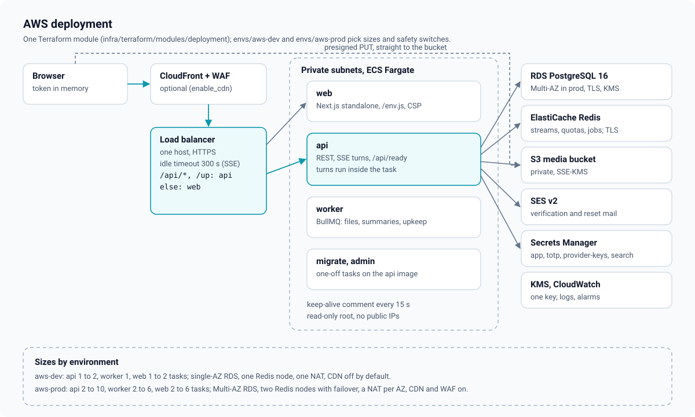

# High-level design

Euron Open AI Chat is a self-hosted, ChatGPT-like assistant for one organisation or
community. A deployment gives its members streamed conversations with any model the
operator configures (OpenAI, Anthropic, Gemini, or anything that speaks the Chat
Completions wire format: Groq, OpenRouter, Together, DeepInfra, Ollama, vLLM, LM Studio),
with web search and page reading, image generation and editing, file attachments that a
model can read or search, projects with shared instructions and knowledge files, memory
across chats, dictation and read aloud, branching (regenerate and edit), and frozen
public share links. Admins run it from an `/admin` control plane in the same web app:
accounts, quota tiers, providers and models, deployment settings, shared links and the
audit trail. Admins never read anyone's conversations.

This page describes the system as it is built: what runs, where data lives, how a request
travels and what happens when a piece fails. Deeper topics have their own pages:

| Topic | Page |
| --- | --- |
| Modules, layers, jobs, rate limits and errors inside the API | [LLD.md](LLD.md) |
| Tables, enums, constraints and indexes | [data-model.md](data-model.md) |
| One turn from question to stored answer: context, tools, branching, titles, summary | [chat-engine.md](chat-engine.md) |
| The turn event log, SSE, resume and cancel | [streaming-and-resume.md](streaming-and-resume.md) |
| Model providers, wire formats, error mapping and keys | [providers.md](providers.md) |
| Tools, SSRF, prompt injection and untrusted content | [tools-and-safety.md](tools-and-safety.md) |
| Uploads, processing, extraction and search | [files.md](files.md) |
| Daily allowances, tiers and overrides | [quotas.md](quotas.md) |
| Security controls and known limitations | [security.md](security.md) |
| STRIDE analysis | [threat-model.md](threat-model.md) |
| Decisions and their trade-offs | [adr/](adr/README.md) |

All code paths are relative to the repository root.

## 1. System context

Everyone uses the same web app; mobile clients call the same API with native sessions
([ADR 0013](adr/0013-native-token-mode.md), [mobile-clients.md](../guides/mobile-clients.md)).
There are two platform roles (`users.role`):

| Role | Can open | Enforced in |
| --- | --- | --- |
| `USER` | Their own conversations, projects, files, memories, images, shares, preferences and usage | Every query is scoped to the actor ([`apps/api/src/services/chat/chat.service.ts`](../../apps/api/src/services/chat/chat.service.ts) `ownConversation`, [`apps/api/src/services/file.service.ts`](../../apps/api/src/services/file.service.ts) `ownFile`) |
| `ADMIN` | All of the above for their own account, plus `/admin`: accounts, tiers, overrides, providers and models, settings, shares moderation, audit, stats | `requireAdmin` in [`apps/api/src/core/context.ts`](../../apps/api/src/core/context.ts), called first by every admin controller |

An admin sees accounts, usage counts and configuration. No admin endpoint returns a
conversation, a message, a memory or a file's content; the only conversation text an
admin can reach is a share someone chose to make public.

The outside systems:

| System | What the chat uses it for | Code |
| --- | --- | --- |
| Model providers (OpenAI, Anthropic, Gemini, OpenAI-compatible, the stub) | Chat answers, titles, summaries, images, transcription, speech | [`integrations/llm/`](../../apps/api/src/integrations/llm/index.ts), [`integrations/images/`](../../apps/api/src/integrations/images/index.ts), [`integrations/speech/`](../../apps/api/src/integrations/speech/index.ts) |
| Web search (SearXNG, Tavily, Exa, Brave, the stub) | The `web_search` tool | [`integrations/search/`](../../apps/api/src/integrations/search/index.ts) |
| Public web pages | The `open_url` tool, through the per-hop SSRF guard | [`integrations/fetch-page.ts`](../../apps/api/src/integrations/fetch-page.ts) |
| Moderation (OpenAI moderation endpoint, the stub, or none) | Optional check of prompts and image prompts | [`integrations/moderation/`](../../apps/api/src/integrations/moderation/index.ts) |
| S3 (private bucket) | Attachments, project files, avatars, generated images, thumbnails | [`integrations/storage.ts`](../../apps/api/src/integrations/storage.ts) |
| Mail (SES v2 or SMTP) | Verification, password reset, the admin bootstrap link | [`integrations/mail/mailer.ts`](../../apps/api/src/integrations/mail/mailer.ts) |

Two flows bypass the API on purpose:

- **File bytes** go straight between the client and the bucket with presigned URLs. The
  API hands out a URL only for a declared, allowlisted file, then verifies what landed
  (size and magic bytes) before anything may use it ([files.md](files.md)).
- **Provider keys** never travel through the database or an API response. They are read
  from the environment (or Secrets Manager on AWS) per call
  ([ADR 0004](adr/0004-providers-behind-one-interface.md)).

## 2. Containers

The repository builds three images. The API image carries four entry points.

| Container | Source | Image | Listens | Role |
| --- | --- | --- | --- | --- |
| Web app | `apps/web` (Next.js 15, standalone) | [`infra/docker/web.Dockerfile`](../../infra/docker/web.Dockerfile) | 3000 (3540 on the host locally) | Pages, `/env.js` runtime config, the per-request CSP. Locally it also proxies `/api/*` to the API ([`apps/web/next.config.ts`](../../apps/web/next.config.ts)) |
| API | [`apps/api/src/index.ts`](../../apps/api/src/index.ts) | [`infra/docker/api.Dockerfile`](../../infra/docker/api.Dockerfile) | 5036 | REST under `/api`, SSE turn streams, `/up` and `/api/ready`. Runs turns |
| Worker | [`apps/api/src/worker.ts`](../../apps/api/src/worker.ts) | API image, `node dist/worker.js` | none | BullMQ workers for the `files`, `chat` and `maintenance` queues and the repeatable schedules |
| Migrate (one-off) | [`db/migrate.ts`](../../db/migrate.ts) | API image, `node dist/migrate.js` | none | Applies pending SQL migrations |
| CLI (one-off) | [`apps/api/src/cli.ts`](../../apps/api/src/cli.ts) | API image, `node dist/cli.js` | none | `admin:create` and `demo:seed` |
| Stubs (local and tests only) | [`apps/stubs/server.mjs`](../../apps/stubs/server.mjs) | [`infra/docker/stubs.Dockerfile`](../../infra/docker/stubs.Dockerfile) | 5129 | Deterministic OpenAI-compatible, Anthropic and Gemini models, images, speech, moderation, search and test pages. Never deployed to AWS |
| SearXNG (local default) | `searxng/searxng` image, [`deploy/compose/searxng/settings.yml`](../../deploy/compose/searxng/settings.yml) | upstream | 8089 on the host | Self-hosted metasearch for `web_search` |

Shared packages:

| Package | Holds |
| --- | --- |
| [`packages/types`](../../packages/types/src/index.ts) | DTOs and enums shared by the API, the web app and mobile clients, including the turn event catalogue ([`events.ts`](../../packages/types/src/events.ts)) |
| [`packages/api-client`](../../packages/api-client/src/index.ts) | The HTTP client (single-flight refresh, cross-tab lock), typed endpoint groups, uploads with progress ([`upload.ts`](../../packages/api-client/src/upload.ts)), the resumable turn reader ([`stream.ts`](../../packages/api-client/src/stream.ts)) |
| [`packages/ui`](../../packages/ui/src/index.ts) | Components and design tokens |

### Deployed shape (AWS)

The composition lives in one Terraform module,
[`infra/terraform/modules/deployment/main.tf`](../../infra/terraform/modules/deployment/main.tf);
`envs/aws-dev` and `envs/aws-prod` only pick sizes and safety switches.

| | aws-dev | aws-prod |
| --- | --- | --- |
| Availability zones, NAT | 2, one shared NAT | 3, one NAT per AZ, interface endpoints |
| RDS PostgreSQL 16 | single AZ, 3 days of backups | Multi-AZ, 14 days, deletion protection |
| ElastiCache Redis | 1 node | 2 nodes with automatic failover |
| Tasks (min to max) | api 1 to 2, worker 1, web 1 to 2 | api 2 to 10, worker 2 to 6, web 2 to 6 |
| CloudFront + WAF | off by default (`enable_cdn = false`) | on by default |
| Log retention | 14 days | 365 days |

**One origin.** The ALB routes `/api/*` and `/up` to the API and everything else to the
web app. The browser only talks to `https://<domain>`, so the refresh cookie (scoped to
`/api/auth`) is first-party. Chat turns stream from the API over Server-Sent Events on the
same path, never through the Next server, so nothing in between buffers them. The ALB
idle timeout is raised to 300 s (`alb_idle_timeout`) and the API writes a keep-alive
comment every 15 s ([`apps/api/src/middleware/sse.ts`](../../apps/api/src/middleware/sse.ts)).
With the CDN on, CloudFront sends a secret `X-Origin-Verify` header the listener rules
require, and passes `/api/*` uncached; `TRUST_PROXY` becomes 2.

**Secrets.** `<prefix>/app` (JWT and refresh secrets), `<prefix>/totp`,
`<prefix>/provider-keys` (the whole JSON object becomes `PROVIDER_KEYS`) and, with a
hosted search provider, `<prefix>/search` are injected by ECS as environment variables
([`infra/terraform/modules/secrets/main.tf`](../../infra/terraform/modules/secrets/main.tf)).
Values start as `set-me` placeholders, which the API treats as "not configured".

### Local shape

`make up` runs [`deploy/compose/compose.yaml`](../../deploy/compose/compose.yaml) with
[`compose.floci.yaml`](../../deploy/compose/compose.floci.yaml): Postgres 16, Redis 7,
Mailpit, the stubs, SearXNG, Floci (the AWS emulator) provisioned by the
`infra/terraform/envs/local-floci` Terraform, then migrate, api, worker and web
([ADR 0014](adr/0014-floci-for-local-aws.md), [quickstart-local.md](../guides/quickstart-local.md)).

| Service | Host port |
| --- | --- |
| web | 3540 |
| api | 5036 |
| Postgres | 5502 |
| Redis | 6439 |
| Mailpit (UI / SMTP) | 8056 / 1056 |
| Floci | 4607 |
| stubs | 5129 |
| SearXNG | 8089 |

## 3. Where data lives

| Data | Store | Notes |
| --- | --- | --- |
| Accounts, sessions, conversations, messages, projects, memories, shares, files metadata, extracted text and chunks, providers and models, tiers, usage, settings, audit | PostgreSQL | One migration, [`db/migrations/0001_init.sql`](../../db/migrations/0001_init.sql) ([data-model.md](data-model.md)) |
| Turn event logs `turn:<id>:events`, cancel flags, pub/sub wakeups | Redis | Kept 3600 s after the last event ([streaming-and-resume.md](streaming-and-resume.md)) |
| Today's quota counters `quota:<user>:<day>:tokens\|images` | Redis | 48 h TTL, seeded from `usage_daily` when missing ([quotas.md](quotas.md)) |
| Rate-limit buckets `rl:<name>` | Redis | In-memory insurance limiter when Redis is down |
| BullMQ queues `files`, `chat`, `maintenance` | Redis | `noeviction` in Terraform |
| File bytes, thumbnails, generated images | S3 (or `DATA_DIR` with `STORAGE=local`) | Private; every read is a short-lived signed URL |
| Provider, search, JWT and TOTP secrets | Environment, from Secrets Manager on AWS | Never in Postgres, never in a response or a log |

## 4. Request flows

### 4.1 Any API request

1. **Request id.** A valid incoming `X-Request-Id` is kept, otherwise a ULID is minted; it
   is echoed in the response and in every error body ([`apps/api/src/app.ts`](../../apps/api/src/app.ts)).
2. **Logging** with pino; signed local file URLs are masked in the logged path and secret
   or content fields are redacted ([ADR 0012](adr/0012-no-conversation-text-in-logs.md)).
3. **Helmet** with a JSON-only CSP (`default-src 'none'`, `frame-ancestors 'none'`).
4. **CORS** for `CORS_ORIGINS` (default `APP_WEB_URL`) with credentials, plus a second check
   that refuses any non-GET with a foreign `Origin` (`403 CORS_ORIGIN_DENIED`).
5. **Cookies and JSON** (2 MB). Files never come through JSON; dictation takes raw audio on
   its own route.
6. **Authentication** per route ([`apps/api/src/middleware/auth.ts`](../../apps/api/src/middleware/auth.ts)):
   the JWT is verified and the user row reloaded, so a ban or `token_version` bump takes
   effect on the next request.
7. **Rate limits** per route or inside the service ([`apps/api/src/middleware/rate-limit.ts`](../../apps/api/src/middleware/rate-limit.ts)).
8. **Controller**: strict zod parse, one service call, status code.
9. **Service**: rules, queries scoped to the actor, transactions, effects after commit.
10. **Errors**: an `HttpError` becomes its status and stable `code`; anything else is logged
    and returned as `500 INTERNAL` with the request id and no detail.

### 4.2 Sending a message

1. The composer uploads attachments first (presigned PUT, then `complete`), then posts
   `POST /api/chats/:id/messages` (`:id` may be `new`) with `Accept: text/event-stream`.
2. `sendMessage` ([`chat.service.ts`](../../apps/api/src/services/chat/chat.service.ts))
   checks the send rate (30 a minute), the message and attachment limits, ownership of every
   file id, the chosen model (vision needed for images), then in one transaction stores the
   question, its `message_files`, an empty `STREAMING` answer, and moves
   `conversations.current_leaf_id` to the answer.
3. `startTurn` ([`turns.ts`](../../apps/api/src/services/chat/turns.ts)) runs the turn
   without awaiting it. The HTTP response is only a subscriber.
4. The turn checks moderation and the daily allowance, builds the context, calls the model
   with tools for up to four rounds, and appends every event to `turn:<id>:events`
   ([chat-engine.md](chat-engine.md)).
5. The response streams those events as SSE. If it drops, the client follows
   `GET /api/turns/:id/events?after=<seq>` on any task and misses nothing.
6. At the end the answer row becomes `COMPLETE` (or `CANCELLED`, `FAILED`), usage is
   recorded, a title is written for a first answer, and `done` closes the stream.

### 4.3 Uploading a file

`POST /api/files` validates type, extension and size and returns a presigned PUT; the
client PUTs the bytes; `POST /api/files/:id/complete` checks the stored size and magic
bytes and queues `files.process`, which re-encodes images (no EXIF, at most 2048 px) or
extracts and chunks documents; only then is the file `READY` ([files.md](files.md)).

### 4.4 Opening a shared link

`GET /api/shared/:id` (public, rate limited by IP) returns the frozen snapshot; images in
it are served by `GET /api/shared/:id/images/:fileId`, a 302 to a short-lived signed URL,
only for file ids frozen into that snapshot ([ADR 0010](adr/0010-frozen-share-snapshots.md)).

## 5. Background jobs

| Job | Queue | When | Does |
| --- | --- | --- | --- |
| `files.process` | files | after `complete` | Image re-encode and thumbnail, or text extraction and chunking |
| `chat.summarize` | chat | after a turn that dropped messages from context | Folds old turns into the rolling summary |
| `chat.title` | chat | registered; not enqueued by the current code | A title from the first exchange (titles are written inline today) |
| `maintenance.sweep-turns` | maintenance | every 2 min | `STREAMING` answers older than 15 min become `FAILED` |
| `maintenance.expire-files` | maintenance | every 30 min | Abandoned, rejected, deleted, unreferenced files and their objects |
| `maintenance.lift-suspensions` | maintenance | every 5 min | Timed suspensions that have run out |
| `maintenance.purge-accounts` | maintenance | every 6 h | Accounts past the 14-day deletion grace period |
| `maintenance.retention` | maintenance | every 6 h | Conversations older than `retentionDays`, when set |

Schedules are in [`apps/api/src/worker.ts`](../../apps/api/src/worker.ts); handlers in
[`apps/api/src/jobs/`](../../apps/api/src/jobs/index.ts). `JOBS_MODE=inline` runs handlers
in the API process (tests, tiny installs) and is refused in production.

## 6. Scaling model

| Component | How it scales | What makes that safe |
| --- | --- | --- |
| API tasks | Horizontally | Sessions in Postgres, rate limits, quota counters and turn logs in Redis. A turn runs in the task that accepted it, but its events can be followed from any task, and a cancel reaches it through Redis pub/sub. No stickiness |
| Worker tasks | Horizontally | BullMQ locks jobs; maintenance steps are conditional updates; repeatable jobs are keyed by name so one schedule exists |
| Web tasks | Horizontally | Stateless; `/env.js` and the CSP are rendered per request |
| PostgreSQL | Vertically | Keyset pagination, partial indexes (live conversations, streaming messages, pending files), generated `tsvector` columns with GIN indexes |
| Redis | Vertically; aws-prod has failover | One subscriber connection per API process for every followed turn |
| Model calls | Bounded by the providers | Per-turn limits (4 rounds, 8 tool calls, 180 s per call), per-user send rate, daily weighted-token allowances |

## 7. Failure modes

| Failure | Effect | Recovery |
| --- | --- | --- |
| Postgres unavailable | `/api/ready` answers 503; the ALB takes tasks out of rotation | RDS Multi-AZ failover in aws-prod |
| Redis unavailable | Readiness fails; a turn cannot write its event log, so it ends `FAILED` (the question is stored); quota counters cannot be read; rate limits fall back to per-task memory | ElastiCache failover in aws-prod |
| A provider is down, slow or rate limiting | The turn ends with `error` `PROVIDER_ERROR` or `PROVIDER_RATE_LIMITED` and a fixed safe message; partial text and usage are kept | The user retries or picks another model; the raw provider body is logged masked, never shown |
| No usable chat model (no key, all disabled) | Send answers `503 MODEL_UNAVAILABLE`; `/api/models` lists nothing | An admin adds a key and enables a model ([providers.md](../guides/providers.md)) |
| The client loses its connection mid-answer | Nothing happens to the turn | The client resumes with `?after=<seq>` within an hour; afterwards the stored message is replayed |
| The API task running a turn dies (crash, deploy) | The answer stays `STREAMING` | `maintenance.sweep-turns` fails it after 15 minutes; the conversation can continue |
| Search provider down | `web_search` returns an error result; the model answers without it | None needed |
| Moderation provider down | Fails open (logged) | None needed |
| Worker down | Uploaded files stay `PROCESSING`; summaries and maintenance wait | Jobs run when a worker returns |
| Mail transport fails | Logged; the request succeeds | The user resends verification or reset |

## 8. What is deliberately not here

- **Multi-tenancy.** One deployment serves one organisation; there is no `tenant_id`
  ([ADR 0001](adr/0001-single-deployment.md)).
- **Billing.** Quotas are allowances an admin sets; there are no plans, prices or payments
  ([ADR 0011](adr/0011-admin-quotas-without-billing.md)).
- **A vector database.** Project and attachment search is Postgres full-text search
  ([ADR 0009](adr/0009-postgres-full-text-search.md)).
- **Vendor SDKs.** Every provider is plain `fetch` and one SSE reader
  ([ADR 0004](adr/0004-providers-behind-one-interface.md)).
- **Admin access to conversations.** There is no endpoint for it.
- **Push notifications, realtime voice, code execution, agents that act on other systems.**
- **Hard deletion of usage history.** Erasing an account removes identity and content;
  `usage_daily` counts stay attached to the anonymised row.
